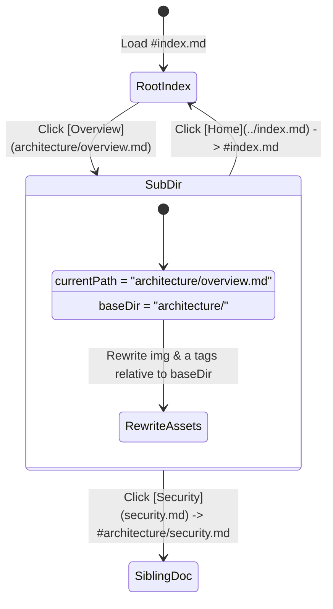

# System Architecture Overview

[← Back to Home](../index.md)

This document resides inside the `architecture/` subdirectory (`#architecture/overview.md`). It tests **relative path resolution**, **subdirectory context**, and **parent directory traversal**.

> [!TIP]
> Open the **Command Palette (`⌘K` / `Ctrl+K`)** and search for `State Machine` or `Subdirectory`. Because `index.md` links to this file, the idle background crawler automatically prefetches, caches, and indexes this page before you even visit it.

---

## 1. Client-Side Routing State Machine

The diagram below illustrates how `index.html` resolves relative links when navigating inside nested folders like `architecture/`:



---

## 2. Relative Path Resolution Matrix

When viewing `architecture/overview.md`, the JavaScript router resolves links relative to `architecture/` using the browser's `URL` constructor:

| Markdown Link Written | Active Document Context | Resolved Hash Route |
| :--- | :--- | :--- |
| `[Home](../index.md)` | `architecture/overview.md` | `#index.md` |
| `[Code Section](../index.md#3-code-highlighting--one-click-copy)` | `architecture/overview.md` | `#index.md#3-code-highlighting--one-click-copy` |
| `[Security Spec](security.md)` | `architecture/overview.md` | `#architecture/security.md` |
| `[Deep Nest](aws/vpc.md)` | `architecture/overview.md` | `#architecture/aws/vpc.md` |

---

## 3. Infrastructure Policy Example (OPA / Rego)

Testing syntax highlighting and the **Copy** button for policy-as-code inside a nested document:

```rego
package system.architecture.routing

default allow_navigation := false

# Allow navigation if target is a relative markdown path without directory traversal above root
allow_navigation if {
    endswith(input.target_path, ".md")
    not startswith(input.target_path, "http")
    not contains(input.resolved_url, "..")
}
```

---

## 4. Test Cross-Document Deep Linking

Click the links below to verify parent traversal and compound hash deep-linking back to the root document:

* [Return to Root Document](../index.md)
* [Jump directly to Root Graphical Diagrams](../index.md#1-graphical-diagrams-mermaidjs)
* [Jump directly to Root Code Highlighting](../index.md#3-code-highlighting--one-click-copy)
