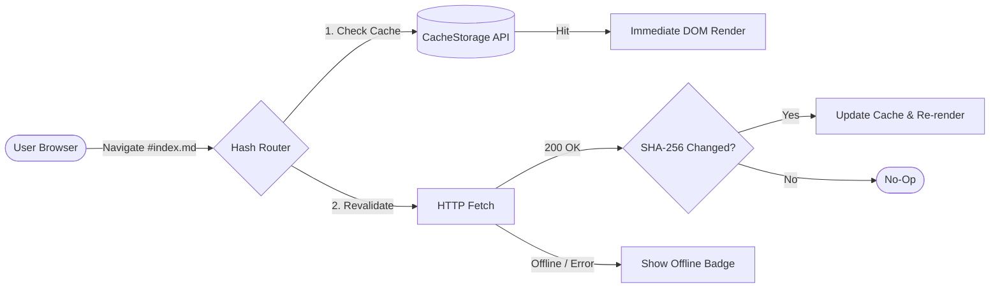
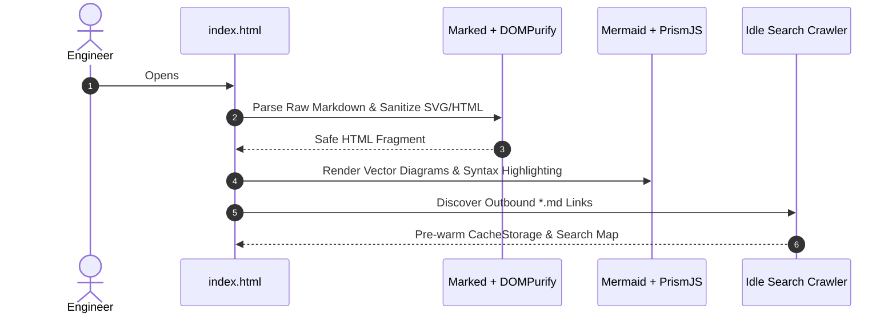

# System Architecture & Platform Documentation

Welcome to the zero-build documentation engine. This `index.md` file serves as a comprehensive test suite for routing, graphical diagram rendering, scroll-spy navigation, offline caching, and full-text search.

> [!NOTE]
> Press `⌘K` (macOS) or `Ctrl+K` (Linux/Windows) at any time to open the Command Palette and search across headings and document content.

---

## 1. Graphical Diagrams (Mermaid.js)

Hover over either diagram below to test the **floating toolbar** (`+`, `−`, `↺`, `SVG`, `PNG`). Use your mouse wheel to zoom toward your cursor, click-and-drag to pan, or double-click to reset the viewport.

### Request & Caching Lifecycle



### Sequence Topology



---

## 2. GitHub Callout Alerts

All five GitHub-flavored blockquote alerts are parsed and styled automatically:

> [!TIP]
> Click the **Node Map** button in the top navigation bar to visualize this document's heading hierarchy and outbound `.md` links as an interactive 2D spring graph.

> [!IMPORTANT]
> Relative links to other Markdown files (such as `[Architecture Overview](architecture/overview.md)`) are intercepted automatically and converted into hash routes without full page reloads.

> [!WARNING]
> Because browsers block `fetch()` over the `file://` protocol, always serve this directory over a local HTTP server (e.g., `python3 -m http.server 8000`).

> [!CAUTION]
> Modifying DOMPurify's SVG whitelist will prevent Mermaid vector nodes from rendering properly.

---

## 3. Code Highlighting & One-Click Copy

Hover over the top-right corner of the code blocks below to test the **Copy** button and PrismJS dynamic language autoloading.

### Go Concurrent Worker Pattern

```go
package main

import (
	"context"
	"fmt"
	"sync"
	"time"
)

func worker(ctx context.Context, id int, jobs <-chan string, wg *sync.WaitGroup) {
	defer wg.Done()
	for {
		select {
		case <-ctx.Done():
			return
		case job, ok := <-jobs:
			if !ok {
				return
			}
			fmt.Printf("[worker-%d] processed: %s\n", id, job)
		}
	}
}

func main() {
	ctx, cancel := context.WithTimeout(context.Background(), 2*time.Second)
	defer cancel()

	jobs := make(chan string, 3)
	var wg sync.WaitGroup

	for w := 1; w <= 2; w++ {
		wg.Add(1)
		go worker(ctx, w, jobs, &wg)
	}

	jobs <- "index.md"
	jobs <- "architecture/overview.md"
	close(jobs)
	wg.Wait()
}
```

### Terraform Static Hosting Configuration

```hcl
resource "aws_s3_bucket" "docs_portal" {
  bucket_prefix = "markdown-docs-engine-"
  force_destroy = true

  tags = {
    Component   = "documentation-engine"
    Environment = "production"
  }
}

resource "aws_s3_bucket_website_configuration" "docs_site" {
  bucket = aws_s3_bucket.docs_portal.id

  index_document {
    suffix = "index.html"
  }
}
```

---

## 4. Structured Data & Deep Linking

Test intra-document deep linking by clicking this anchor to jump back to [Graphical Diagrams](#1-graphical-diagrams-mermaidjs), or hover over any heading to see its `#` permalink.

| Feature Module | Technology Used | Offline Capable |
| :--- | :--- | :--- |
| **Markdown Parser** | `marked.js` (GFM enabled) | Yes (after initial load) |
| **XSS Sanitizer** | `DOMPurify` (SVG whitelisted) | Yes |
| **Vector Graphics** | `Mermaid.js` + Custom Pan/Zoom | Yes |
| **Document Cache** | Native `window.caches` + `SubtleCrypto` | Yes (SWR lifecycle) |
| **Search Index** | In-Memory `Map` + `requestIdleCallback` | Yes (pre-warmed) |

---

## 5. Multi-File Routing & Subdirectory Links

To test multi-file navigation, the background search crawler, and the **Node Map** graph edges, create any of the linked files below in your directory:

* [Getting Started Guide](getting-started.md) — Test sibling file routing (`#getting-started.md`).
* [System Architecture Overview](architecture/overview.md) — Test subdirectory path resolution (`#architecture/overview.md`).
* [API Reference: Authentication](api/reference.md#authentication) — Test cross-document deep linking (`#api/reference.md#authentication`).
